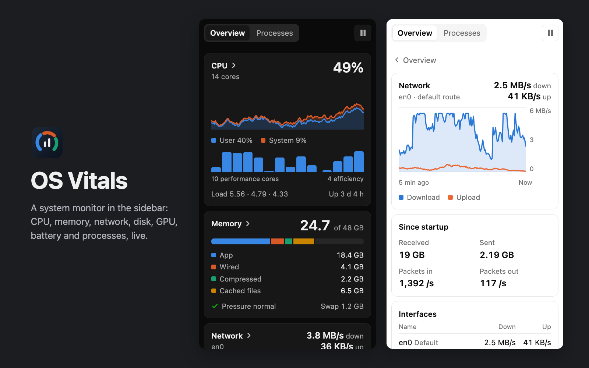
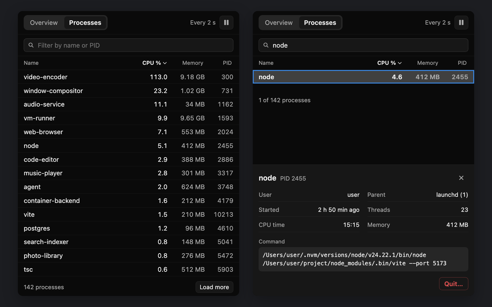

# Orca plugins

[](https://github.com/pblobp/orca-plugins/actions/workflows/ci.yml)
[](https://github.com/pblobp/orca-plugins/actions/workflows/codeql.yml)
[](https://scorecard.dev/viewer/?uri=github.com/pblobp/orca-plugins)
[](LICENSE)

Plugins for the [Orca](https://github.com/stablyai/orca) desktop app. Each plugin lives in its own
folder under `plugins/` and has its own version. All of them are free, open source under the MIT
license, and collect no data about you.



## Plugins

| Plugin                                   | What it adds                                                                                                                                | Status                  |
| ---------------------------------------- | ------------------------------------------------------------------------------------------------------------------------------------------- | ----------------------- |
| [OS Vitals](plugins/os-vitals/README.md) | A system monitor in the right sidebar and the status bar: CPU, memory, network, disk, GPU, battery and a process table, with a memory alert | 1.0.0, not released yet |

No plugin is released yet. Each row gets an install link when its plugin is released.

## Screenshots

OS Vitals, drawn by the panel's own code with sample data.

The Overview: CPU with its cores, memory, network, disk, GPU and battery.


The Processes view: sort, filter, and the details of one process, with Quit.



The CPU and Memory views, in the light theme. Every chart has a crosshair and tooltip.


The Network and Energy views.


## Install

A released plugin is listed in the Orca plugin directory at [orca.dev/plugins](https://orca.dev/plugins).
Install it from Orca's Settings, under Plugins, or with Orca's CLI:

```sh
orca plugin install pblobp.<plugin id> --catalog community
```

You can also add this repository as a catalog source. Orca then lists the plugins in
`orca-catalog.json` and updates them from this repository:

```sh
orca plugin catalog add pblobp/orca-plugins
```

Before a plugin runs any code, Orca shows you the access it asks for and waits for your approval.
Read that list before you approve it.

## What a plugin can do on your machine

A plugin with a worker (execution level `trusted-worker`) runs a Node process as you. It can read
your files and use your network. Orca does not sandbox it. Orca also updates installed plugins by
itself, about 12 hours after a new release is listed. A bad release would reach every user, so
this repository checks every change and limits who can release. [SECURITY.md](SECURITY.md) explains
what those rules protect and what they cannot.

The access each plugin asks for:

| Plugin    | Execution        | Capabilities                         | Programs it runs                                                                                                                                                                        | Network |
| --------- | ---------------- | ------------------------------------ | --------------------------------------------------------------------------------------------------------------------------------------------------------------------------------------- | ------- |
| OS Vitals | `trusted-worker` | `settings:own`, `notifications:show` | On macOS, system tools that report usage (`ps`, `vm_stat`, `sysctl`, `ioreg`, `netstat`, `route`, `df`, `pmset`, `top`); on Linux, `nvidia-smi` when it exists; on both, Orca's own CLI | None    |

Each plugin's README explains every item in its row. The exact programs and Node modules a plugin
may use are listed in `policy/<plugin id>.json`, and CI rejects code that uses anything else.

## Repository layout

```text
plugins/<id>/     the plugin as Orca installs it
policy/<id>.json  the Node modules, programs and hosts that plugin may use
tests/<id>/       unit tests and cleaned fixtures, run by plain Node
tools/<id>/       development tools, such as a smoke test
scripts/          the repository checks, the release script and the settings script
docs/             how to add a plugin, the standards, releasing, repository settings
```

Only `plugins/<id>/` reaches users. Tests, fixtures and tools stay outside it.

## Contributing

Read [CONTRIBUTING.md](CONTRIBUTING.md). Propose a new plugin with an issue before you write it.
Questions and bug reports: see [SUPPORT.md](SUPPORT.md).

## OpenSSF Scorecard

The Scorecard badge is here for openness. With one maintainer and a young repository, the checks
for code review and project age score zero, so expect a score of about 5 out of 10.

## License

[MIT](LICENSE). Each plugin folder carries a copy of the license, because Orca installs only that
folder.
