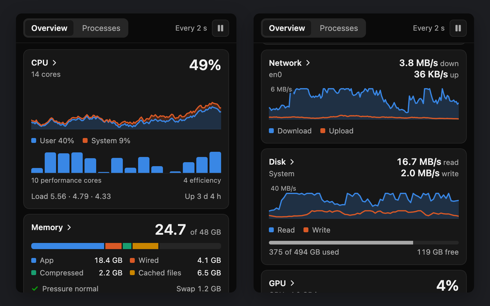
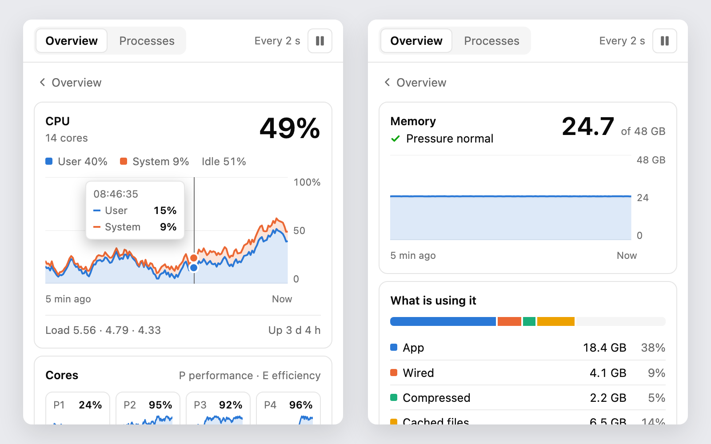
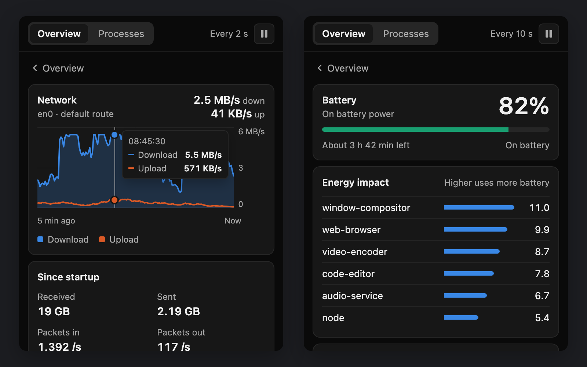

# Orca plugins

[](https://github.com/pblobp/orca-plugins/actions/workflows/ci.yml)
[](https://github.com/pblobp/orca-plugins/actions/workflows/codeql.yml)
[](https://scorecard.dev/viewer/?uri=github.com/pblobp/orca-plugins)
[](LICENSE)

Free, open-source plugins for the [Orca](https://github.com/stablyai/orca) desktop app. They collect
no data about you.


## Plugins

| Plugin                                   | What it adds                                                                                                                    | Version                                                         |
| ---------------------------------------- | ------------------------------------------------------------------------------------------------------------------------------- | --------------------------------------------------------------- |
| [OS Vitals](plugins/os-vitals/README.md) | A system monitor in the sidebar and the status bar: CPU, memory, network, disk, GPU, battery and processes, with a memory alert | [1.0.0](https://orca.dev/plugins/pblobp/orca-plugins/os-vitals) |

## Screenshots

| Overview                                                                                                               | Processes                                                                                                                         |
| ---------------------------------------------------------------------------------------------------------------------- | --------------------------------------------------------------------------------------------------------------------------------- |
|  |       |
| **CPU and Memory**                                                                                                     | **Network and Energy**                                                                                                            |
|      |  |

## Install

Install from Orca's Settings, under Plugins, or with Orca's CLI:

```sh
orca plugin install pblobp.os-vitals --catalog community
```

Orca shows the access a plugin asks for and waits for your approval before it runs any code.

## Security

A plugin with a worker runs as you, with no sandbox, and Orca updates installed plugins by itself.
So every change here goes through a pull request with required checks, and only the maintainer can
tag a release. Each plugin's README lists the access it asks for, and `policy/<plugin id>.json`
lists the programs and Node modules it may use. [SECURITY.md](SECURITY.md) says what these rules
protect, what they cannot, and how to report a problem.

## Contributing

Read [CONTRIBUTING.md](CONTRIBUTING.md), and propose a new plugin in an issue before you write it.
Questions and bug reports: [SUPPORT.md](SUPPORT.md).

## License

[MIT](LICENSE)
