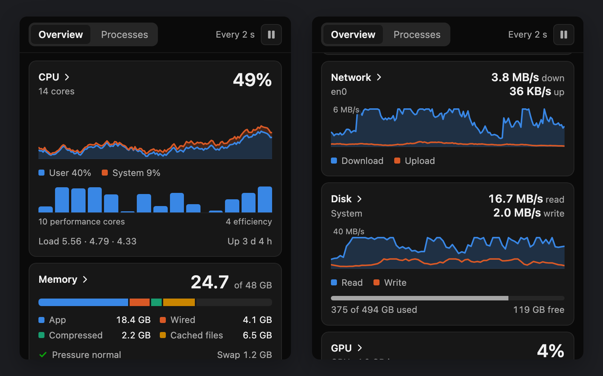
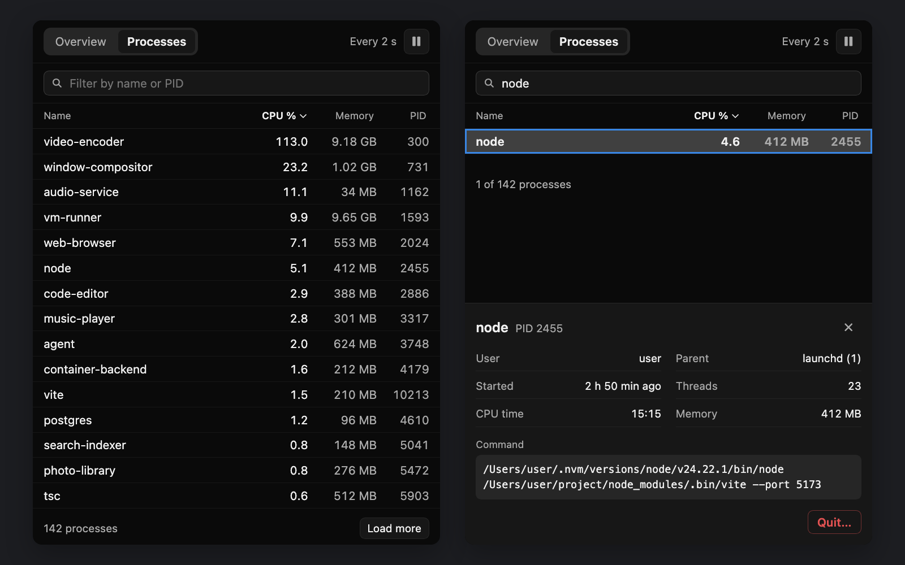
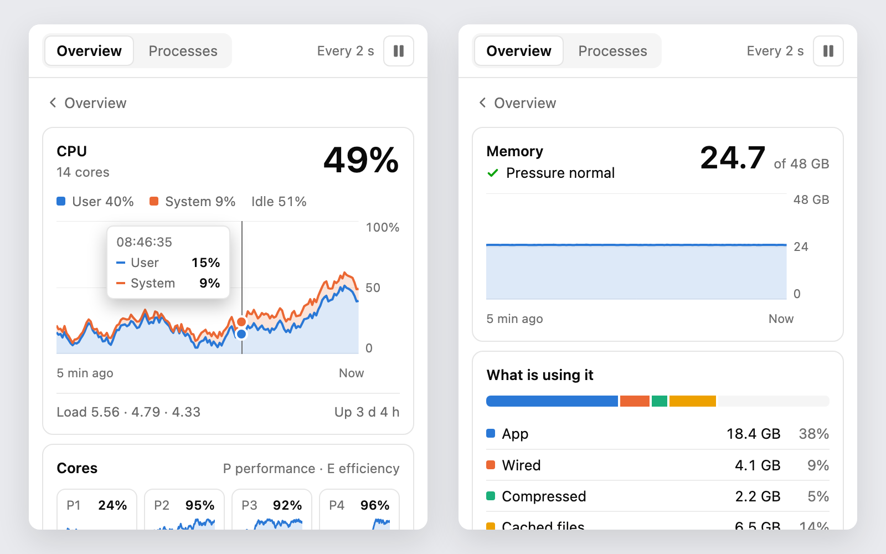

# OS Vitals

A system monitor for [Orca](https://github.com/stablyai/orca). A panel in the right sidebar draws
live CPU, memory, network, disk, GPU, battery and processes, and an item in the status bar keeps
the current numbers in view while you work. It runs on macOS and Linux; Windows and other systems
get CPU and memory.



## Install

Once OS Vitals is listed, install it from Orca's plugin directory: open Orca's Settings, choose
Plugins, and search for OS Vitals. With Orca's CLI:

```sh
orca plugin install pblobp.os-vitals --catalog community
```

You can also install it from this repository's own catalog:

```sh
orca plugin catalog add pblobp/orca-plugins
orca plugin install pblobp.os-vitals
```

Before it runs any code, Orca shows the access it asks for (listed under
[The access it asks for](#the-access-it-asks-for)) and waits for your approval. OS Vitals needs the
Orca desktop app; Orca's browser client loads a panel as a single inlined document, and this panel is
made of several files.

## What it shows



- **Overview.** One card per part of the system. Each card's title opens its detail view, and the
  Overview control at the top of a detail view (or Escape) goes back.
  - CPU: total usage with its user and system parts over the last minutes, the load on each core
    (performance cores first, then efficiency cores, on Apple silicon), the load average and how
    long the system has been up.
  - Memory: memory in use out of the total, with memory pressure and swap. On macOS it is split
    into app memory, wired, compressed and cached files, and memory in use is app memory plus
    wired plus compressed, the same formula Activity Monitor uses. On Linux it is split into used,
    buffers and cached, where used is the total minus what the kernel reports as available, the
    same figure `free` shows; pressure comes from `/proc/pressure/memory` when the kernel has it.
    On Windows it is used and free, where free is what Windows reports as available.
  - Network: download and upload rates over time, and the interface that carries the default route.
  - Disk: read and write rates over time, and the startup disk's used and free space.
  - GPU: GPU use over time and the GPU memory in use. Hidden on a computer that reports no GPU
    reading.
  - Battery: charge and time left. A Mac without a battery shows an Energy card here instead.
  - The five processes using the most CPU, with a link to the full list.
- **Detail views.**
  - CPU: a larger chart with its scale, each core's load over time, and the processes using the
    most CPU with their CPU time.
  - Memory: memory in use over time, each part with its size and share, swap, and the processes
    using the most memory.
  - Network: rates over time, bytes received and sent since startup, packets per second, and every
    interface that carried traffic in the last reading.
  - Disk: rates over time, reads and writes per second, bytes read and written since startup, and
    every local volume with its used and free space.
  - GPU: use over time, GPU memory, the renderer's share and the peak over the history.
  - Energy: the battery, each process's energy impact (the same measure Activity Monitor shows),
    and the apps that keep the computer awake. Linux has no per-process energy measure, so there
    the view shows the battery and the power it draws, and a Linux computer without a battery has
    no Energy view.
- **Processes.** Every process with its CPU, memory and PID. Filter by name or PID, sort by any
  column, and load 100 more rows at a time. Select a row (or press Enter or Space on it) to see its
  user, parent, start time, threads, CPU time, memory and command line, and to quit it. Escape
  closes the details.
- **Status bar.** `CPU 23% · MEM 61%`, updated at most every 5 seconds and only when a number
  changes. Its tooltip shows the load average and memory, and why it is coloured when an alert is
  on. Pressing it opens the panel.



Point at a chart to read the values at that moment; a line marks the moment and a box lists the
time and each value. A chart can also take keyboard focus (Tab): the left and right arrow keys move
the marker one reading at a time, Page Up and Page Down ten, Home and End to the oldest and newest,
and Escape hides it. A screen reader reads each chart's current values and its scale. The two
views at the top are a tab list: the left and right arrow keys move between them.

Every chart has one scale, labeled at its top. CPU and GPU charts run from 0 to 100%, memory from 0
to the total. Network and disk charts pick the next round value above the highest reading in view,
so a burst raises the scale, and the label says so, instead of being cut off.

**Units.** Sizes and rates use binary units: 1 KB is 1,024 bytes, 1 MB is 1,024 KB and 1 GB is
1,024 MB, the way Activity Monitor and `top` count memory. Disk sizes therefore read a little lower
than Finder's, which counts 1 GB as 1,000,000,000 bytes.

The pause button at the top stops the panel's readings and shows when the last one was taken; the
status bar item and the alerts keep running. Press Resume to carry on.

### Alerts

- **Memory** (on by default): when memory pressure is critical, or memory in use stays at or above
  the limit you set (92% by default) for 30 seconds, OS Vitals shows one desktop notification, such
  as "OS Vitals: memory is critical. 96% of memory is in use. video-encoder is using 9.65 GB." It
  reads the process list once, at that moment, to name the process using the most memory. Then the
  alert stays silent for 10 minutes. The status bar item turns red while memory stays high, and
  amber while memory pressure is elevated.
- **CPU** (off by default): CPU at or above the limit you set (90% by default) for a minute turns the
  status bar item amber. It sends no notification.

If Orca does not show a notification (for example, when notifications are not allowed for the
plugin), OS Vitals writes one line to its log and does not try again until the next alert.

### When it reads what

The panel asks its worker for new readings every 2 seconds while it is open (the refresh interval
setting changes this). When you switch to another sidebar tab or close the sidebar, Orca removes the
panel and the polling stops with it. While the panel is open the worker also reads network every
refresh, disk I/O and GPU every second refresh (every refresh while the Disk or GPU view is open),
and the disk space, battery and default route every 30 seconds. While it is closed it keeps only CPU
and memory, every 5 seconds, for the status bar and the alerts, so the network, disk and GPU charts
start empty when the panel opens and fill in from then on. The process list is read only while the
panel shows it: every 2 seconds in the Processes view, every 4 seconds for a top five. Energy impact
and the apps keeping the computer awake are read every 10 seconds, and only while the Energy view is
open. With background sampling off, nothing runs while the panel is closed: no timers and no
programs.

### What it costs

Measured on an Apple M4 Pro with about 1,050 processes, at the default 2-second refresh. The worker
is the plugin's own Node process; the programs are the system tools it runs, from their measured
CPU time per run and how often they run.

| State                                 | Worker     | Programs                            | Total, % of one core |
| ------------------------------------- | ---------- | ----------------------------------- | -------------------- |
| Panel open on the Overview            | 0.42%      | about 1.9%                          | about 2.3%           |
| Panel open on the Energy view         | about 0.6% | about 7.8% (`top` takes most of it) | about 8.4%           |
| Panel closed, background sampling on  | 0.08%      | about 0.05%                         | about 0.13%          |
| Panel closed, background sampling off | 0%         | none                                | 0%                   |

## The access it asks for

When you install OS Vitals, Orca asks you to approve this list.

| Access                           | Why                                                                                                                                                                                                                     |
| -------------------------------- | ----------------------------------------------------------------------------------------------------------------------------------------------------------------------------------------------------------------------- |
| Runs a worker (`trusted-worker`) | The panel cannot read the system. A Node process does it for the panel, as your user, with no administrator rights. Because the plugin has a status bar item, Orca keeps the worker running while the plugin is enabled |
| `settings:own`                   | Reads the settings below, which you change in Orca's Settings                                                                                                                                                           |
| `notifications:show`             | Shows the memory alert, and the current numbers when the panel cannot be opened from the status bar                                                                                                                     |
| Panel `OS Vitals`                | The panel in the right sidebar                                                                                                                                                                                          |
| Status bar item `OS Vitals`      | The CPU and memory readings in the status bar                                                                                                                                                                           |
| Command `OS Vitals: Open panel`  | Opens the panel. The status bar item runs it when you press it                                                                                                                                                          |

### Programs it runs

| Program                                              | When                                                                                                                               | Why                                                                                                                                                                                                                                                                                                                                                                                                                                                                  |
| ---------------------------------------------------- | ---------------------------------------------------------------------------------------------------------------------------------- | -------------------------------------------------------------------------------------------------------------------------------------------------------------------------------------------------------------------------------------------------------------------------------------------------------------------------------------------------------------------------------------------------------------------------------------------------------------------- |
| `/usr/bin/vm_stat`                                   | macOS, every 5 seconds while the status bar or alerts need it, and every refresh while the panel is open                           | Memory page counts: app memory, wired, compressed and cached files                                                                                                                                                                                                                                                                                                                                                                                                   |
| `/usr/sbin/sysctl`                                   | macOS, with every `vm_stat`                                                                                                        | Reads `hw.memsize`, `vm.swapusage` and `kern.memorystatus_vm_pressure_level`: total memory, swap and memory pressure                                                                                                                                                                                                                                                                                                                                                 |
| `/bin/ps`                                            | macOS, only while the panel shows processes or the Energy view is open, when you open a process's details, and right before a quit | `ps -A -o pid= -o ppid= -o uid= -o pcpu= -o rss= -o time= -o lstart= -o user= -o comm=` lists processes. For details, `ps -p <pid>` adds the command line and `ps -M -p <pid>` counts threads. Before a quit, `ps -p <pid> -o lstart= -o uid= -o comm=` reads that one process again                                                                                                                                                                                 |
| `/usr/sbin/ioreg`                                    | macOS, once when the worker starts, then every second refresh while the panel is open (every refresh in the Disk or GPU view)      | `ioreg -p IODeviceTree -c IOPlatformDevice` tells performance cores from efficiency cores, once. `ioreg -r -d 2 -w 0 -c IOBlockStorageDriver` reads the bytes and operations each disk has read and written. `ioreg -r -d 1 -w 0 -c IOAccelerator` reads GPU use and GPU memory                                                                                                                                                                                      |
| `/usr/sbin/netstat`                                  | macOS, every refresh while the panel is open                                                                                       | `netstat -ibn` reads the bytes and packets each network interface has received and sent                                                                                                                                                                                                                                                                                                                                                                              |
| `/sbin/route`                                        | macOS, every 30 seconds while the panel is open                                                                                    | `route -n get default` names the interface that carries the default route                                                                                                                                                                                                                                                                                                                                                                                            |
| `/bin/df`                                            | macOS, every 30 seconds while the panel is open                                                                                    | `df -kPl` lists other local volumes and their free space. The startup disk's space comes from the file system directly, with no program                                                                                                                                                                                                                                                                                                                              |
| `/usr/bin/pmset`                                     | macOS, once when the worker starts, every 30 seconds while the panel is open, and every 10 seconds while the Energy view is open   | `pmset -g batt` reads the battery's charge, whether it is charging, and the time left. `pmset -g assertions`, only in the Energy view, lists the apps that keep the computer awake                                                                                                                                                                                                                                                                                   |
| `/usr/bin/top`                                       | macOS, every 10 seconds, only while the Energy view is open                                                                        | `top -l 2 -s 1 -o power -n 30 -stats pid,power` measures each process's energy impact. It takes two samples a second apart and only the second is used, because the first reports zero for every process                                                                                                                                                                                                                                                             |
| `/usr/bin/nvidia-smi` or `/usr/local/bin/nvidia-smi` | Linux, once when the worker starts to find an NVIDIA GPU, then every second refresh while the panel is open, only if it was found  | `nvidia-smi --query-gpu=utilization.gpu,memory.used,memory.total,name --format=csv,noheader,nounits` reads GPU use, GPU memory and the GPU's name. These two fixed paths are the only places it is looked for                                                                                                                                                                                                                                                        |
| Orca's own CLI                                       | Only when you press the status bar item or run the command                                                                         | Orca has no call that opens a plugin's panel, but its CLI does. The worker runs `orca plugin list --json` to learn its own install key, then `orca plugin open <key> --panel os-vitals --json`. It runs the copy inside Orca's application folder (`Orca.app/Contents/Resources/bin/orca` on macOS, `resources/bin/orca-ide` beside Orca on Linux), never one found on `PATH`. If it cannot find or run it, it shows a notification with the current numbers instead |

On Linux nothing else is run: processes, memory, network, disk and battery come from files (see
below). Every program runs directly by its full path, without a shell, with `LC_ALL=C`, a timeout of 1.5
seconds (4 seconds for `top`, 10 seconds for Orca's CLI) and a cap on its output. A program that fails three times in a
row turns its section off instead of failing the whole reading. None of them needs administrator
rights.

### What it reads

| Source                                                                                                                                                                                                                                                                                                                                                                                                                                                                            | What for                                                                       |
| --------------------------------------------------------------------------------------------------------------------------------------------------------------------------------------------------------------------------------------------------------------------------------------------------------------------------------------------------------------------------------------------------------------------------------------------------------------------------------- | ------------------------------------------------------------------------------ |
| Node's `os` module: CPU times, load average, uptime, total and free memory                                                                                                                                                                                                                                                                                                                                                                                                        | The CPU card, the status bar, and memory on Windows                            |
| The programs above                                                                                                                                                                                                                                                                                                                                                                                                                                                                | Memory, processes, core types, network, disk, GPU, battery and energy on macOS |
| On Linux, these files, read directly with no program: `/proc/meminfo`, `/proc/pressure/memory`, `/proc/uptime`, `/proc/<pid>/stat`, `/proc/<pid>/status` and `/proc/<pid>/cmdline` for every process, `/proc/net/dev`, `/proc/net/route`, `/proc/diskstats`, `/proc/mounts`, `/sys/block/<disk>/device` (to leave out loop, RAM and device-mapper devices), `/sys/class/power_supply/BAT*`, `/sys/class/drm/card*/device` (AMD GPU use and memory) and `/etc/passwd` (user names) | Memory, processes, network, disk, GPU and battery on Linux                     |
| On Linux, `statfs` of `/` and of each real mounted device                                                                                                                                                                                                                                                                                                                                                                                                                         | The Disk card and view                                                         |
| The startup disk's size and free space (`statfs` of `/System/Volumes/Data`)                                                                                                                                                                                                                                                                                                                                                                                                       | The Disk card and view                                                         |
| The names of the links in `/Volumes`                                                                                                                                                                                                                                                                                                                                                                                                                                              | The startup disk's name, such as Macintosh HD                                  |
| Its own file path                                                                                                                                                                                                                                                                                                                                                                                                                                                                 | Telling an installed copy from a development copy when it opens its panel      |

Process names and command lines are shown in the panel as plain text and never leave your machine.

### Privacy: what it never does

- No network access. It connects to nothing, and the panel's frame has no network either.
- No telemetry, analytics or data collection. Nothing leaves your machine. Readings stay in the
  worker's memory for the history length you choose and are gone when the worker stops.
- It writes no files. The panel remembers only which view you used last, in its own browser storage.
- It never signals a process you have not confirmed in the panel.

## Quitting a process

Select a process in the Processes view and press **Quit…**. A confirmation names the process, its
PID, when it started, who owns it and its command line. When you confirm, OS Vitals' worker sends
it `SIGTERM`, the same signal `kill <pid>` sends from a terminal, as your user account and with no
extra rights. A well-behaved program saves and exits. If it is still running 5 seconds later, the
panel offers **Force quit…**, which sends `SIGKILL` after a second confirmation; the program then
gets no chance to save anything.

The worker, not the panel, decides. Right before each signal it checks, in this order, and sends
nothing if a check fails:

1. **The PID is above 1.** PID 1 starts every other process.
2. **You own it.** Processes of other users and of the system are refused (`not_owner`).
3. **It is still the same process.** The worker reads that one PID again, with `ps` on macOS and
   from `/proc/<pid>/stat` on Linux, where the start time is field 22 in clock ticks since boot. If
   it has exited, the answer is `gone`. If its start time, owner or name differ from the list you chose it
   from, or the worker never listed it, the answer is `changed`: the PID was reused, and the new
   process is never signalled.
4. **It is not part of Orca.** Not the worker, not the processes that started it, and nothing
   inside Orca's application (`Orca.app` on macOS, the folder that holds Orca on Linux).
5. **It is not in the protected set** (all in `src/protected.ts`): anything under `/System/`,
   `/usr/libexec/`, `/usr/sbin/` or `/sbin/`; `loginwindow`, `WindowServer`, `Dock`, `Finder`,
   `WindowManager` and `launchd`; Orca's helpers outside its application, meaning any path that
   contains `/orca/daemon-host/` (quitting the terminal daemon would end every Orca terminal and
   agent), the process named `Orca`, and anything whose name starts with `Orca` followed by a
   space, such as `Orca Helper` (an unrelated app such as OrcaSlicer is not protected); and on Linux `systemd`, `gnome-shell`,
   `Xorg`, `Xwayland`, `kwin_*`, `plasmashell`, `gdm*`, `sddm`, `dbus-daemon`, `dbus-broker`,
   `pipewire`, `wireplumber`, `sshd` and `login`.

Kernel threads on Linux are listed but never quit; they answer `protected`. Checks 4 and 5 answer
`protected` too. If the system refuses the signal, the answer is `not_permitted`.
The details pane shows Quit only for processes that pass the checks the list can make, and says why
for the others. Processes started from Orca's terminals, such as dev servers and agents, are not
protected: stopping a runaway one is the point.

## Settings

Change them in Orca's Settings, under OS Vitals. Each one applies at once, without a restart. A value
outside its allowed range is ignored and the default is used.

| Setting                          | Default        | What it does                                                                                                                                                                             |
| -------------------------------- | -------------- | ---------------------------------------------------------------------------------------------------------------------------------------------------------------------------------------- |
| Refresh interval                 | 2 seconds      | How often the panel updates while it is open: 1, 2 or 5 seconds                                                                                                                          |
| History length                   | 5 minutes      | How far back the charts reach: 1, 5 or 15 minutes. A shorter history keeps the newest readings that fit                                                                                  |
| Status bar                       | CPU and memory | CPU and memory, CPU, memory, or hidden                                                                                                                                                   |
| Sample while the panel is closed | On             | Reads CPU and memory every 5 seconds for the status bar and the alerts while the panel is closed. Off, nothing runs while the panel is closed, and the alerts work only while it is open |
| Memory alert                     | On             | The memory notification and the red status bar item described under [Alerts](#alerts)                                                                                                    |
| Memory alert limit (%)           | 92             | Memory in use, from 70 to 99%, that counts as high                                                                                                                                       |
| CPU alert                        | Off            | Turns the status bar item amber when CPU stays high for a minute                                                                                                                         |
| CPU alert limit (%)              | 90             | CPU use, from 50 to 100%, that counts as high                                                                                                                                            |
| Open on                          | Last used      | The view the panel opens on: the last one you used, Overview, or Processes                                                                                                               |

## Platforms

| Feature                               | macOS                                          | Linux                                                                | Windows and others                        |
| ------------------------------------- | ---------------------------------------------- | -------------------------------------------------------------------- | ----------------------------------------- |
| CPU total, user, system               | Yes                                            | Yes                                                                  | Yes                                       |
| Per-core load                         | Yes                                            | Yes                                                                  | Yes                                       |
| Performance and efficiency cores      | Yes                                            | No                                                                   | No                                        |
| Load average                          | Yes                                            | Yes                                                                  | No                                        |
| Uptime                                | Yes                                            | Yes                                                                  | Yes                                       |
| Memory                                | App, wired, compressed, cached, pressure, swap | Used, buffers, cached, swap, and pressure when the kernel reports it | Used and free only                        |
| Processes and their details           | Yes                                            | Yes, from `/proc`                                                    | No                                        |
| Quitting a process                    | Yes                                            | Yes                                                                  | No                                        |
| Status bar item                       | Yes                                            | Yes                                                                  | Yes                                       |
| Memory and CPU alerts                 | Yes                                            | Yes                                                                  | Yes, from used memory and CPU             |
| Opening the panel from the status bar | Yes                                            | Yes                                                                  | No: shows a notification with the numbers |
| Network, disk I/O and disk space      | Yes                                            | Yes                                                                  | No                                        |
| GPU use and memory                    | Apple silicon and Macs that report it          | NVIDIA (with `nvidia-smi`) and AMD; not Intel                        | No                                        |
| Battery                               | Yes                                            | Yes, with the power it draws                                         | No                                        |
| Energy impact and what keeps it awake | Yes                                            | No: Linux has no per-process energy measure                          | No                                        |

### What was verified where

- **macOS:** the panel inside Orca 1.4.261, every view, on an Apple M4 Pro; the readers, the quit
  flow (on processes started for the test) and the cost above, on the same Mac.
- **Linux:** the readers and the smoke test in real Debian and Alpine containers (including a
  container that sees the host's 200 kernel threads), and in CI on Ubuntu. The panel has not been
  checked inside Orca on Linux; its code is the same on every system.
- **NVIDIA and AMD GPUs:** from sample output only; not checked on real GPUs.
- **Windows:** CPU and memory through the smoke test in CI; the panel has not been checked inside
  Orca on Windows.

### Known limits

- No per-process network use: `nettop` takes about 5 seconds, too slow for a live view.
- No temperatures or fan speeds: macOS needs administrator rights or private interfaces for them.
- No Wi-Fi or Ethernet label on interfaces: telling them apart needs another program.
- Desktop app only, and tested on Orca 1.4.261.
- History lives in the worker's memory and starts over when Orca restarts the plugin.
- A section whose program or file keeps failing turns itself off; the Overview says which, and it
  comes back when Orca restarts the plugin.

## Development

From the repository root:

```sh
orca plugin validate plugins/os-vitals --json
orca plugin test plugins/os-vitals --json      # src/worker.test.ts, with orca/testing
node --test 'tests/os-vitals/**/*.test.ts'      # unit tests
node tools/os-vitals/smoke.ts                   # samples this machine
node tools/os-vitals/serve.ts                   # the panel in a browser with a fake Orca
```

`tools/os-vitals/serve.ts` serves `tools/os-vitals/harness.html`, which loads the real panel files
with a fake `window.orca` that answers with generated readings. `?scenario=` picks `loading`,
`error`, `unsupported`, `windows`, `flaky`, `empty`, `pressure`, `desktop` (no battery), `nogpu`,
`fresh` (the panel just opened, so network, disk and GPU history is short), `spike` (a network
burst) or `linux` (Linux memory, kernel threads, an NVIDIA GPU, a battery with its power draw, no
energy impact), `?theme=light` the light theme, `?view=` a view (`processes`, `cpu`, `memory`, `network`,
`disk`, `gpu` or `energy`), `?energy=wait` keeps the Energy view measuring, and `?act=` runs steps
after load (`tab:` or `click:` a button by its text, `filter:<text>`, `select:<name>`,
`focus:<name>`, `key:<key>`, `hover:<chart>:<fraction>`, `chart:<chart>` to focus a chart,
`scroll:<px>`, `reveal:<card title>`, `measure`, `wait:<ms>`, `probe`, separated by commas).
`?neutral=1` uses made-up process, CPU and volume names, for the listing images. The `t` key switches theme.
`tools/os-vitals/gallery.html` shows several widths and states side by side,
`tools/os-vitals/gallery-views.html` the Overview and every detail view in both themes,
`tools/os-vitals/gallery-states.html` chart hover and keyboard, 220 px, no battery, no GPU, a
spike and a freshly opened panel, `tools/os-vitals/gallery-platforms.html` the Linux and Windows
scenarios, and `tools/os-vitals/gallery-quit.html` every step of quitting a
process. The fake quits `node` at once, keeps `vite` running until it is forced, and refuses `tsc`
(`changed`), `agent` (`not_permitted`) and `watchman` (`gone`).

The listing images in `media/` are rendered from the harness, with the real panel code and made-up
data, by `node tools/os-vitals/make-media.ts` while `tools/os-vitals/serve.ts` runs. The pages it
renders are in `tools/os-vitals/media/`; pass file names (such as `cover.png`) to render only those.
It uses Google Chrome at its default macOS path, or the one in `CHROME`.
